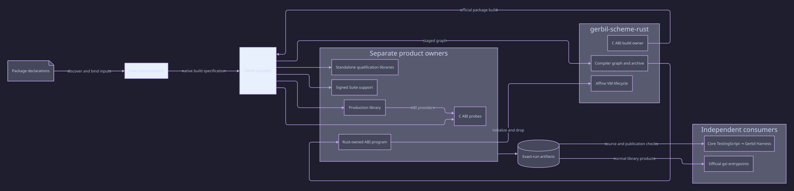

#+TITLE: CI ownership and branch retirement
#+LANGUAGE: en

* Authority
The current dependency cohort is read only from gerbil.pkg. Yuanxu PR19 owns
the formal source revisions; earlier receipts retain their recorded source epoch.
Gerbil is the compiler; Yuanxu/Core owns its module and publication protocols.
GitHub Actions owns job dependencies and artifact transport.

* Two product responsibilities
| Product | Native entry | Ownership |
|---------+--------------+-----------|
| Library | build.ss | Existing init-selected normalized production spec |
| FFI fixtures | build-ffi-tests.ss | Existing C headers, actual objects, link options and ordered producer phases |
| Research programs | build-language-conformance.ss | Declare actual program/library roots; Core package-library-spec discovers imports; Gerbil compiles and links normal products |
| Rust ABI program | t/fixtures/rust-language-abi/build.ss and Cargo build.rs | Official C ABI package operations; upstream graph/archive builder and affine VM lifecycle |
| Test support | build-test-support.ss | Core for-directory/for-files discovers full native Suite support; exact std-make-spec value enters Core building/script for compilation, artifact admission and subset publication |

Research products and signed test-lib publications have different output and
admission domains. Each has one native build entry. Combining them as a single
superset would lose those distinctions. Both use the existing compiler host
initializer; support does not rewrite Core's returned spec. Its own build and
compiler-policy source files are observed inputs. No builder, signer or import
walker is implemented in Parser.

Development and CI consume signed support through Core TestingScript, which
checks source, outputs and approvals before invoking native gerbil test. The
shared test-native command never compiles; test-all prepares its prerequisites.
The complete test profile retains3GiB/900s. No test file starts a build or another
test harness.

FFI precedes support consumption. Research declares entry sources once, not
transitive fixture names. Normal package import discovery covers research-only
helpers such as provenance-language even if no native Suite imports them.

* CI consolidation
Six consumers share one native composite action: existing compiler activation,
download products from the current workflow run, extract with native tar. Release/root/
head environment is declared once. Consumers have no build-on-restore fallback.

Compiler-policy and five research Suite reruns were removed after actual
MODULE-OK records confirmed all six in the complete183-module entry. No Suite,
Case or Fixture was removed. The retired custom-loader CPU item was removed;
native load/reload/error/observation controls remain in the full Suite entry.
Source witness freshness, isolated macro phases, deliberate failure, process
ownership, Rust claim selection, platform corpus and manual research have distinct
purposes and remain. Test-lib is included in the existing complete-prefix snapshot;
failed-product custody also retains it, without granting recovery admission.

* Failure controls and source epochs
The cold package prefix failure was a HOME/configured-prefix mismatch; correct
native storage creation passed a missing-parent negative and registered-file
positive control. The FFI order failure was reproduced with15 products preserved;
its existing producer fixed the same-command header failure. Missing research
root coverage was reproduced with32 provenance products preserved; projected
real roots rebuilt the static module and the compiled program passed15 checks.

These observations preceded the new Core test-lib handoff. Its first combined
research/test experiment hit idle5 and revealed the responsibility mismatch;
that log is retained. Final acceptance requires the corrected two-owner path on
the current dependency cohort and exact PR head. Two workers and existing heaps/
watchdogs remain. Parser's former180s package cap stays removed; Djot is paused.
Gerbil source and the compiler installation are unchanged.

* Git retirement
Local and remote heads retain only main and codex/final-event-offset-aot. Obsolete
maintenance/scheme and fix/native-scheme-cohort-20261021 remote heads were deleted
with expected-SHA leases. Local archive refs/stale PR pointer were removed after
complete Git bundle custody; the active alignment branch took the real PR name.
All five retired refs, including the unmerged policy commit, restored in a temporary
bare repository and passed fsck. No default branch/history rewrite or merge occurred.
The integration custody is parser-retired-branches-20261027.bundle; the temporary
verification repository was removed. Other repositories were not cleaned.

* Evidence boundary
Official actionlint1.7.12 and YAML parsing passed. The initial revised native
entry passed183 modules plus separate test-plan Suite, zero ERROR and catalog
checks. Linux/macOS preparation, artifact recovery and downstream
claims remain independent gates at PR13; prior local/remote epochs are not reused
as acceptance of the new Core cohort.

* Cold preparation failure correction
CI40493930934 retained two distinct failures. macOS reached the dependency POO
entry's180-second shebang deadline (status124), despite two configured workers.
The formal POO PR removes this package-level cutoff; Core carries its revision
through the existing dependency chain. Parser keeps only Core as a direct
runtime dependency. Compiler activation also retains the existing2GiB/debug
options alongside the relocated Gerbil paths, rather than overwriting them.
No compiler/SDK source or heap increase is involved.

Linux completed production and signed test-support publication, then failed to
link the standalone records library: its runtime-record-assignments grammar had
no normal static product. Signed test-lib support is not a replacement for that
normal static closure. The conformance entry now declares the actual library
root records-engine-abi; Core package-library-spec derives its imports. No
transitive fixture roster, loader or consumer build fallback is added.

* Transport is not framework admission
The custom .gerbil/ci/identity file and its five-field comparison are removed,
along with the pack/restore script modes and duplicated prepared-head variable.
GitHub transports the named current-run/platform artifact; native tar preserves
its bytes, modes and timestamps. The shared action only activates, downloads and
extracts. It does not certify source currentness, method results or approvals.

Core TestingScript retains its independent source/input/output/approval checks
when consuming test support. Gerbil/std-make own ordinary compiled products;
existing runtime/qualification controls retain their separate claims. The CI
workflow adds no replacement manifest, credential, loader or admission layer.
The remaining failed-products.sh only preserves diagnostic outputs and source
observations; it cannot issue approval. The former identity-file negative test
is retired machinery, not evidence of framework admission correctness.

* Repeated mechanism audit
Removed the CI-only Scheme bootstrap and its Suite: compiler archive SHA256 is
already checked against the configured download; a second hardcoded release
schema/revision/platform approval and a private worker detector add no compiler
capability. GitHub environment files now publish only normal Gerbil relocation
and2GiB runtime options. The workflow declares two workers. The macOS PATH roster
and installer-path assertion are also removed; GitHub action/native PATH updates
select installed tools without an invented whole-host identity.

Removed the dependency-cache trial Function admission and update fallback.
Cache restoration is transport, and native deps --install checks package metadata
on every path. Removed unconditional gerbil clean: std/make owns freshness;
clean/retry must not serve as a correctness repair.

Removed the custom conformance linker, object timestamp/options/translation
stamps, private task queue and sixteen-module grouping. Core projects actual
research/library input imports; std/build-script declares the research executable
and std/make owns object scheduling, reuse and linking. The previous closure
validator and its self-mirroring test belonged only to the deleted linker.
Compiler host-option tests and domain loading/error/mutation controls remain.
Conformance is a package build, not a runtime liveness test. Its extra build
supervisor and build-conformance.ss driver are removed as well; CI invokes the
standard declaration directly. This follows the removed Parser package-build
cutoff; the outer CI job deadline remains. Runtime negative controls and their
watchdogs are not changed.

Retained download SHA256 checks (archive integrity), platform C/link flags,
native GitHub download/extract composition, and diagnostic failure custody.
None issues framework approval. Core owns source/input/output/approval checks;
CI transports archives and invokes native package/test entries. No replacement
manifest, cache verdict, package manager or loader is introduced.

The native gxpkg final retag operation invokes one gxtags process for all package
source directories; gxtags imports each .ss/.ssi and retains native expander
contexts across that process. Linux logs prove a2GiB failure in that child, not
in Parser compilation. They do not yet identify the last source/module or the
largest retained context. Failure custody now includes only pkg/TAGS or pkg/tags
when present, alongside compiled outputs, so partial native progress survives.
Package source/.git remains excluded. No replacement tags tool, ignore-errors
path, forged success or changed heap is used. This source-level observation does
not establish a repaired Linux retag operation.

The top-level command entries delegate product declarations to their modules.
=src/cli/build.ss= owns the optional gparse executable, and
=t/research/build.ss= owns the standalone conformance executable and its closure.
=src/ffi/shared-library/build.ss= uses public Gerbil compile-module and compile-exe
to produce the C-hosted shared library with its runtime shim and linker options.
compiler-profile.ss retains host compiler options and process-output forwarding,
not target discovery or a second scheduler. The shared setup/restore GitHub
composites are step reuse only. failed-products.sh is diagnostics only.

Local native executable qualification after this removal remains open: one
Mac Homebrew process had no live compiler children and sampled mostly device
select after entering native object compilation. It was stopped after preserving
logs and a process sample. This is not compiler/runtime acceptance, does not
prove the specific retaining/wait cause, and is not repaired by reinstating the
custom linker. The installed compiler and remote configured compiler have
separate source identities; both must be reported independently.

* CI-aligned source and ABI qualification
The old local default resolves to Gerbil1cfb032/patch618d76f9eb72, while CI uses
Gerbil2591dcd/patchf5cedd8168cb on Gambitdcd677c. The configured CI compiler is
already installed locally and is selected through its own activate script;
no compiler source, global Homebrew link or private compiler build is changed.
The old prefix's dynamic objects are refused as ABI-incompatible by that compiler.
The native Parser workspace .gerbil now owns its freshly installed Core/POO and
the existing dev dependency. Runtime tagging retains the default format.

Local qualification must retain CI's compiled-library/source-parent load path
order, GCC16 selection and OpenSSL provider selection. Missing these is distinct
from Parser liveness. A further target declaration defect was found: research
and shared-library executables omitted native pkg-config OpenSSL link options.
An ambient LIBRARY_PATH masked that omission while the compiler archive's link
record referenced an older Homebrew Cellar path. Actual link targets now use
std/make pkg-config-libs, as existing POO executable declarations do; no custom
path resolver or LIBRARY_PATH fallback is added.

The CI-aligned native build exposed actual duplicate ownership: generic research
projection rebuilt records ABI modules without their owner's native link flags.
Research now derives its exclusions from the normalized init Scope declaration,
the FFI owner's exported ffi-build-spec and its executable spec. The public Core
source registration API is used in both phases just as in build.ss. The actual
records grammar remains in Core's import closure, so the standalone library does
not lose its required static source. No parallel FFI path list or link driver is
introduced. FFI still owns its normal compile/clean/spec/meta protocol.

Native research compilation and a new process running provenance completed with
15 real checks. Earlier waits are not evidence of a Parser deadlock on the
qualified CI baseline. The complete test entry and restored consumers remain
separate gates. The model observation input now names build-language-conformance.ss
instead of the deleted linker; all six existing input controls passed, including
missing-source rejection.

The OpenSSL target fix was independently qualified after preserving the prior
executable and relinking with LIBRARY_PATH/LDFLAGS unset. Native Homebrew tool
activation selected pkg-config, CI's PKG_CONFIG_PATH selected OpenSSL3, and
std/make passed its current link options. The new executable then passed15
provenance checks in a new process. Output tokens such as std/log/level#ERROR in
verbose declarations are not runtime/compiler failure records. The actual native
commands exited0. Full earlier182-module results remain tied to their source
cohort; this relink establishes only the changed executable-link boundary.

* Default indexing regression and heap scope
Green CI40460992173 (c3e3dc91, Core0e3c1f8/POO29c58aa) used the same
2591dcd/patchf5 compiler and completed native package retagging. Its setup
published relocation options only. Commit44c61d6e added max-heap=2G globally;
14629cf2 retained it while removing the bootstrap wrapper. That changed gxtags
as well as compiler processes. The earlier statement that14629cf2 first added
the limit is superseded by this exact history.

The retained default-format diagnostic repeatedly forced GC without releasing
registry entries. Live bytes grew from87,745,536 (260 registry keys) to
1,877,202,272 (3,135 keys), then overflowed the2GiB heap. This establishes
cumulative native source-context retention, not an Emacs-format allocation
cause. The diagnostic is not installed behavior or a performance receipt.

The user authorized restoring the green scope. Compiler activation again
publishes relocation only. All preparation compilation steps retain a2GiB
process environment; POOc0d4763 and Core86d2b9a establish that limit in their
native package interpreter invocations and child compiler environments so dependency compilation remains
bounded while the parent package manager and final gxtags use native defaults.
The complete native test profile remains3GiB/900s, workers remain2, and Core's
existing300s package deadline is retained. Parser has no180s package deadline.

Dependency installation still invokes ordinary gerbil deps --install with
fail-fast shell semantics. No retry fallback, format selection, source omission,
registry mutation, or ignored install failure is added. Native tag scalability
under an additional2GiB limit is a separate unresolved property; the green
configuration never established it. Fresh dual-platform CI and native recovery
must qualify this changed cohort; old green or local records are not reused as
current-head acceptance.

* Shared-library host compiler policy
The shared ABI adapter omitted the existing compiler host initialization.
On the local host, even after native Homebrew activation, gcc's unresolved ld
name selected the Nix executable through PATH and the final dynamic-library
link reported unresolved system C symbols. The primary compiler entry already
selects /usr/bin for Homebrew collect2 on Darwin unless the caller explicitly
sets COMPILER_PATH. The shared ABI entry now calls that same initializer before
compilation. There is no new linker resolver or altered SDK. The original
native-shared-pkg-config failure log is retained independently of OpenSSL.

The synchronized responsibility view is [[file:ci-ownership.d2][CI ownership]].

* Local indexing receipt limitation
The final native installation on Core86d2b9a/POOc0d4763 returned0 without a
format override. Its TAGS output was empty, so this is not a valid-index receipt.
A single-file control preserves the distinction: the installed standalone
 gxtags executable skips POO object.ss with either relative or absolute paths;
 gxi calling the same tool's public module entry tags it and emits about17KiB.
These are diagnostics only. The public module call is not substituted into
package installation. Fresh portable CI remains an independent required check;
the local standalone/module behavior difference is unresolved and cannot be
hidden behind the successful package-manager exit status. No compiler source or
installed executable was edited.

* Exact CI compiler and independent control
The macOS release archive matches CI SHA256
8d9c88434aed6301eaebb719bf52472f05c2368eafc630e8a9f1d67cc9895a21.
Its standalone gxtags also skips POO object.ss. A further control outside any
package declaration uses /tmp/gxtags-independent-control/minimal.ss containing
only `(export answer)` and `(def answer 42)`. The executable reports SKIP and
writes zero bytes; the public tool module reports TAG and writes113 bytes. Thus
the observation is not confined to Homebrew or Parser/Core source content.
No distribution file is modified, and module invocation remains diagnostic.

CI now directly checks that the package-manager TAGS output is nonempty after
both dependency installs. Core/POO provide exported symbols, so an empty index
cannot qualify this cohort. This is a normal output check, not a credential,
loader, alternate tool or format switch. The native install's failures still
propagate before this check; no failed cache is saved as a successful install.
The standalone-tool behavior is not repaired by the heap-scope correction and
remains open under the no-Gerbil/SDK-edit constraint.

The retained Core86d2b9a/POOc0d4763 complete local Harness executed182 modules
but failed the unchanged POO grammar-object benchmark: p95=120.498ms exceeded
max_total=100ms. Other recorded checks did not fail. MODULE-OK count does not
supersede ERROR CHECK/HARNESS. No threshold increase, manifest reduction or
retry-as-fix is used. A new cold prefix preserves the whole old prefix and log,
uses the exact CI archive and newly published Core original-source observations;
it is a distinct source/compiler qualification, not repair evidence by cleaning.

* Development compiler budget and complete build inputs
ASP's existing PR13 now publishes3054db6: its native build interpreter and child
compiler environment establish the same2GiB limit, without affecting the parent
package manager's final retagging. The native meta command passed on the exact
CI archive. dev/gerbil.pkg selects that formal revision; the sole runtime
dependency declaration remains Core. This preserves the native dependency
installer instead of reconstructing its compilation/indexing phases in Parser.

The existing conservative model-input discovery also covers dev Scheme owners,
shared compiler/restore actions and dev/gerbil.pkg. Its existing changed/missing
and new-owner controls cover these inputs; all six controls pass. These hashes
bind observations to the real build selection, not to parser-semantic claims.

Compiler-step GAMBOPT values append the2GiB options to the activated relocation
options; they must not replace the distribution's ~~ paths. The package manager
retains relocation-only options and still invokes the unmodified native tool.

* Shared ABI idle failure and redundant import removal
The exact-CI-archive preparation reached native research/static compilation,
then the shared ABI adapter hit its existing30s idle control before main emitted
output (elapsed30.680s, status137, empty adapter log). Original products/logs
remain preserved. No90s/30s control was changed.

The CLI still manually imported gerbil/compiler and each ABI root before loading
build-shared-library.ss. That duplicate bridge is removed: the adapter imports
the compiler API normally and compile-module owns the wrapper's actual imports.
This is a source change requiring new execution evidence, not a clean/retry
claim. The compiler host initializer and target-local pkg-config link options
remain owned by the adapter.

Removing the preload reached adapter main in roughly2s but did not close the
idle gate: compile-module then imported the real closure without observable C
artifacts for30s. That second failure is retained independently. The adapter
now uses the existing compiler-profile completed-import/evaluation reporting
inside its native compile call. No new driver, heartbeat or importer is added;
original import errors/results and the90s/30s controls remain authoritative.

* Current PR source cohort and standalone roots
PR13 retains Core a8030b1 and released POO v0.1.2. The older native-tool-entry
research branch diverges before twenty subsequent source-cohort commits and must
not replace them. Only its published compiler activation repair is reused.
Linux selects the published tags-context lifetime repair; Darwin selects the
published official tool-entry repair, retaining compiler2591dcd and its VM.
The existing source catalog now includes the capture-prefix controls and the
structured lexical fixture as explicit standalone runtime roots. These are
loaded by qualification entrypoints outside Suite import discovery. Core retains
closure discovery, admission and the native build specification. Host logical
CPU capacity replaces fixed two-worker settings. All existing Suite, native TAGS
nonempty, watchdog and heap checks remain mandatory. Fresh CI is required.

The standalone roots belong to research-entry-sources in the existing normal
package-library-spec owner, not the Suite roster. Core's test publication
intentionally excludes interpreted Suite roots and writes support to test-lib;
adding these files to for-files cannot make load-module find normal products.
The normal research owner now declares all existing CI runtime-loaded entry
sources. Core discovers their dependencies and preserves the existing FFI/
production producer exclusions. No loader, source roster walker or new build
entry is introduced. The signed Suite source roster remains unchanged.

* Current Darwin linker receipt
The clean maintained distribution builds Core/POO and the Parser production
library. The optional gparse executable then fails with missing crypto. Its
declaration lacked the existing std/make pkg-config-libs binding already used
by research and the Rust AOT generator. The package entry now declares that
OpenSSL dependency directly, reusing the isolated earlier repair. Standalone
research targets also declare both package and include header roots, matching
their existing FFI producer. No CI library-path injection or compiler swap is
added. Full native checks remain required after this link correction.

* Full Suite and ABI owner corrections
Run41575227804 passes all three Rust lanes and Linux preparation, generation,
corpus and FFI. Complete Linux Harness exits42 for two existing architectural
contracts: the new public-interface Suite bypasses the common Engine, and the
package contract duplicates an obsolete ASP revision. All six public-interface
Cases retain their original fresh-process imports and assertions while using
the existing Engine. The package contract checks the immutable ASP owner format,
as its adjacent Core check already does; manifests remain the revision authority.
No dependency pin, test selection, performance gate or rejection control changes.

The preceding generic Rust-probe declaration was insufficient: Linux later
resolved a split foreign object before its Rust symbol provider. Its two symbols
belong to the real Rust host. The upstream C ABI ownership section below
supersedes that failed declaration and removes the competing producer.

The first local combined focused invocation reached its120s bound and is retained
as failure evidence. Standard test-file owns prerequisite publication followed by
an unchanged per-file120s runtime gate. The complete signed-source native Suite
still has its original3GiB/900s contract. Focused evidence cannot replace it.

* Complete local native entry
The persistent isolated prefix uses the unchanged declared dependency and
compiler pins. The existing preparation sequence completes production/library
catalog checks, optional commands, FFI products, language conformance and signed
test support. The existing shared-library command reports
SHARED-LIBRARY-COMPILED and SHARED-LIBRARY-OK for the real Darwin dylib.
The original test-native entry then reports183 MODULE-OK records, HARNESS-OK
and OK. The entire command exits naturally with status0 and its owned processes
are reaped. This preserves compilation2GiB, Suite3GiB/900s and host CPU capacity.
Raw failures, the complete successful output and process diagnostics remain in
ignored cache storage. Exact-head remote CI is a separate required result.

* Upstream C ABI ownership
On Linux, the fixture's ELF dependencies name the installed ABI objects.
The test child initializes those providers through Gerbil's loader before
restoring the signed test overlay and invoking GxTest. This keeps C
callbacks and Scheme registration on the same ABI instance. Yuanxu still
admits the signed artifacts and supervises the complete test roster.

The Rust ABI fixture consumes gerbil-scheme-rust PR18 at
838af1ab4e6c0c8177fed176efba448c694012b5 through Cargo only. Its build dependency
uses GerbilRuntime to invoke the canonical bridge build.ss and the fixture's
Scheme declarations in one affine owner. Gerbil's compiler stages the dependency
graph; gerbil-scheme-aot-build owns native compilation, linkage and archive
validation. Parser does not discover linker flags or spawn a second tooling VM.
The separate historical IR code generator remains on its existing revision:
the current upstream PR no longer exports that package.

The fixture build.ss emits compiler-owned Scheme products without invoking gsc;
the upstream archive builder supplies their single native producer. The old
archive operand environment variable and reverse Rust-to-gxi link script are
removed. Generic FFI and research preparation exclude the Rust-owned probe.
No gerbil-scheme-rust entry belongs in gerbil.pkg.

The standard just prepare-rust-abi entry builds through Cargo and publishes the
fixture into the selected Gerbil prefix. Local FFI qualification requires this
preparation, just as its existing compiled-library prerequisites do. CI uses the
same entry. It contains no compiler/linker policy or alternate VM runner.

Preparation publishes the exact-head/platform executable alongside existing
Scheme products. Consumer checks retain the original staticlib build90s/idle30s
and runtime90s/idle5s. The real Rust ownership source, foreign-thread rejection,
Source edits,2handles,113result releases and100calls remain unchanged. The
executable initializes LinkedGerbilProgram, calls the Scheme contract and drops
the upstream runtime naturally before reporting RUST-ABI-OWNER-CLEANUP-OK.
Compilation is preparation work; no runtime deadline is enlarged to include it.

Darwin's previous generation and public C ABI failures reach MODULE-LOAD and
then exceed idle5s. The existing observation helper now uses Gambit's official
module resolver hook, as the upstream runtime does. It delegates every lookup
unchanged and restores the previous resolver through dynamic-wind on success
and failure. Only real resolver activity reports progress: no timer heartbeat,
loader selection changes or artificial admission are introduced.

* Local upstream integration evidence
The Cargo-owned isolated package prefix builds through the canonical bridge
build.ss, then stages and links the real Parser module graph. The executable
passes every existing ownership and Source edit assertion and reports cleanup
before natural exit. The guarded isolated run exits0 in1.946s under the original
90s/idle5s contract. The independent default staticlib build exits0 in2.400s
under90s/idle30s; it does not enable the embedded runtime dependency feature.
Rust workspace tests report171passed with the same2ignored tests as the existing
suite. Darwin's original public C ABI and structured lexical generation entries
both pass their unchanged gates (49.586s and11.547s). Generated Rust is formatted
and byte-compared against the checked-in fixture. These are local results;
exact-head GitHub checks and the complete Scheme Suite remain separate gates.

* Whole-script observation scope
Run41594674168 passes all Ubuntu checks and Darwin FFI. Darwin generation instead
exposes an unobserved entry: loading observations.ss only defines callbacks; it
does not observe a subsequent CLI script. The header generator therefore reaches
idle5s before either output receipt. That failure remains retained.

All eight affected source/generator commands now wrap their entire official
script load and main invocation in the existing module-evaluation observer.
The load operation is Gambit's load-module-or-file, exactly the operation used
by gxi-main; the original script, arguments, receipts, formatting and golden-byte
comparisons remain. No alternate resolver, dependency catalog or loader cache is
introduced. Module-evaluation observation composes the official native resolver
hook with the existing expander import/evaluation parameters. The two formerly
interface-only diagnostic scopes use that same composition. The existing
failure-identity test checks that all three hooks restore after failure.
The90s/idle5s gates still constrain the complete script execution.

The Darwin Suite's separate failure is the existing50-pair Grammar construction
benchmark:20samples, P95=120.759ms against100ms. The gate and workload remain
unchanged and all samples are retained. This is not a Rust FFI failure and no
performance improvement is inferred from the observer correction.

Local generators may compile products in the selected prefix. Running them
concurrently with signed test-support publication invalidates that publication;
the native test entry correctly refuses build-required before launching a child.
Complete local validation therefore serializes generation, support publication
and the native Suite. An earlier raw Suite log cannot stand in for the refused
attempt. CI consumers retain separate runner prefixes and exact-run artifacts.

The corrected local generation job completes all13verification stages with the
original guards and golden comparisons. After serial support publication, the
original complete native Suite exits naturally0 with183MODULE-OK, HARNESS-OK and
OK. Its unchanged Grammar construction gate reports20samples and P95=46.114ms
against100ms. That local observation does not erase the retained Darwin failure
or establish a construction optimization; the new exact-head CI must test both
platforms again.
