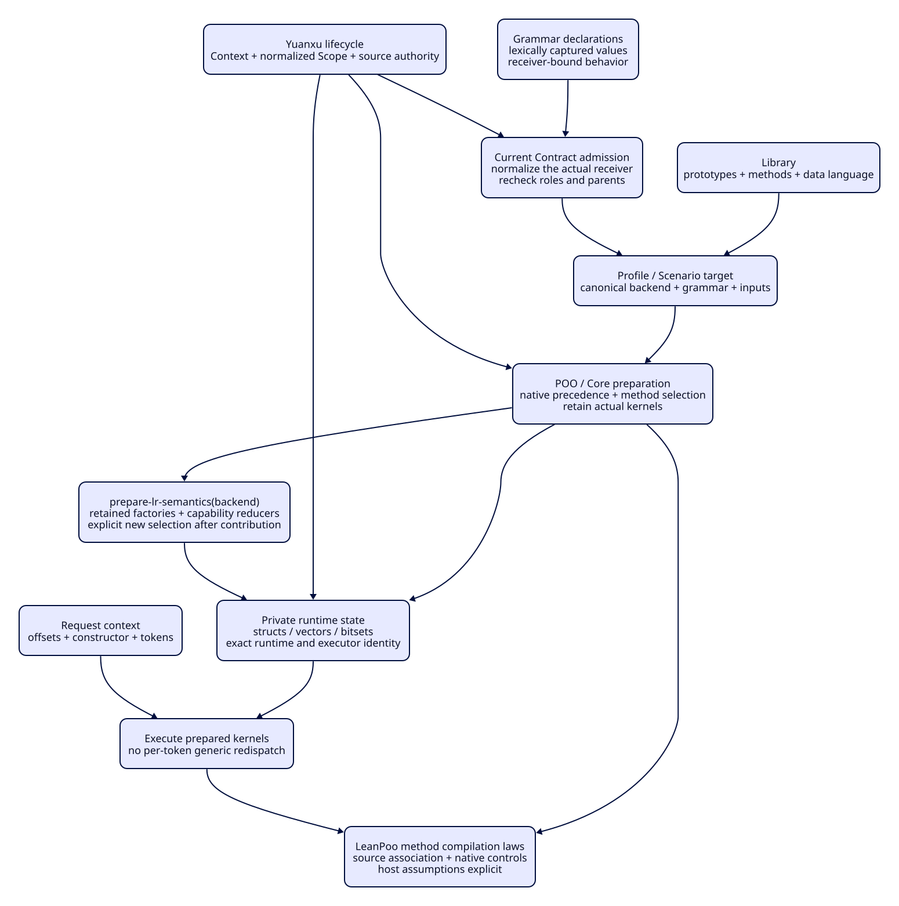

#+TITLE: POO Parser Engine Organization
#+LANGUAGE: en

* Goal and source baseline

POO owns engine composition, preparation and extension. Contracts admit those
objects; they are not the architecture itself. Concrete private state remains
Gerbil structs/vectors where its ownership and execution properties require it.
This is a staged object engine: choose/compose methods, prepare actual kernels,
then execute the retained kernels with request-local context.

LeanPoo PR13 is pinned at e229504ef2219463a237812335bb545b1f8419b9 through the
normal Lake declaration and lockfile. Its 17 upstream checks pass at inspection.
Parser's existing 273-target proof package builds with that revision without a
Lean toolchain change. SemanticPreparation additionally imports the new upstream
MethodCompilation laws instead of duplicating continuation composition proofs.
Gerbil POO/Core remain on the declared dependency chain; no direct POO dependency
or compiler patch is introduced to use APIs already provided by Core.

* Engine responsibilities

| Concern | Existing files | POO responsibility | Concrete representation / boundary |
|---------+----------------+--------------------+------------------------------------|
| Grammar families | grammar/declaration-{types,objects}.ss | Prototype inheritance, declaration composition and typed publication | Shared Record; semantic normalizer owns grammar meaning |
| Compiler stages | compiler/{normalize,lr-compiler,lr-lookahead}.ss | Compose/select stage capabilities and builders; prepare once | FIRST/lookahead bitsets, worklists and native indexes retain their algorithms |
| Semantic backends | runtime/reduction-plan.ss; lr-parser/prepare.ss | Native prototype families and Core multi-argument method selection | Retained callable plans, never generic lookup for every token |
| Scanner and lexical policy | runtime/source-scanner.ss; lexical-lexer.ss | Context/Mode-specific strategy composition and preparation | Worker-owned nominal scan/checkpoint structs and byte offsets |
| Runtime and reuse | runtime/lr-parser/{state,checkpoint,transfer}.ss | Explicit creation/rebind/recovery coordination and capability compatibility | Exact runtime/executor identity, private stacks and snapshots |
| Artifact/query projection | graph/graph-query-*.ss | Caller-selected Row/Id/Kind and compatible collection operations | Typed Map/index policy; stable ordering and reference closure remain domain obligations |
| Module/source lifecycle | init.ss; subsystem Types/Config/Build | Core Context/Scope, selection and normalized publication | Core source admission and Gerbil std/make retain authority |
| Verification | formal/ParserEngine; native/source tests | Reuse LeanPoo inheritance/method/selection laws with explicit host premises | Source-currentness, native semantics, resource gates and research measurements stay distinct |

A hot-path struct is not an alternative object system. It is the engine-owned
representation selected by the object protocol. Replacing every vector/bitset
with a generic collection or redispatching on every character would not establish
better engine organization or a performance improvement.

* Construction optimization boundary

The installed POO source matches the current v0.1.3 release. Comparing the
locked Yuanxu source with the inspected PR head changes source observations,
not object-family or Contract construction. A revision update alone therefore
does not establish a construction improvement.

The fifty-pair construction workload includes admission of each GrammarRole
and admission of its enclosing Grammar. The latter rechecks the supplied role
against the current value Type and contextual Contract. Instrumenting the
public value-Type boundary records 100 role validations, 50 role membership
checks and 50 grammar validations for fifty pairs. These are call counts from
an instrumented diagnostic, not a substitute for the original timing gate.
Its nested CPU measurements are inclusive and must not be summed as exclusive
phase costs.

Previously admitted values can become invalid through mutable declaration
lists or changed descriptor obligations. Construction must reject both cases;
an unversioned success cache is invalid. The existing Contract admission suite
now exercises those changes at the constructor boundary, including restoration
of the original descriptor after the negative control.

Compiled ABBA experiments compare the original constructors with two public
POO API alternatives: inherited constant-field prototypes and constant-slot
construction retaining the original super. Neither experiment establishes a
stable end-to-end improvement. They remain local research evidence; neither
alternative is selected for production. Preserve every sample and separate
CPU, elapsed time, collection time and allocation counter interpretation.

The maintained constructors instead use POO's native lexical slot shorthand
for already evaluated arguments. This lowers to constant specifications in the
same compact construction layout, retaining the original super and full
validation. Receiver-dependent behavior, including the role section method,
remains a receiver formula. This removes unnecessary formula declarations; the
compiled ABBA comparison does not establish an end-to-end speedup, so that is
not claimed as a resolution of the performance gate.

The next optimization must reduce measured repeated preparation, receiver
rebinding or allocation while retaining native inheritance, normalization and
fresh contextual obligations. A focused comparison cannot replace the full
Scheme suite or its unchanged twenty-sample, 100 ms gate. Parser adaptation
and exact-head CI precede Orgize; ASCENT follows Orgize.

* Grammar syntax and ordered normalization

Gerbil's markup change separates byte scanning, typed nodes and output. Its
TAL compiler reports malformed syntax at the source location. Its HTML
scanner uses byte classification tables and bounded name probes with a tree
fallback. The benchmark program selects an operation and input size for each
invocation. [[https://git.cons.io/mighty-gerbils/gerbil/pulls/1515][Gerbil PR 1515]]

Parser's grammar macros retain syntax objects through expansion and lower to
checked Grammar and GrammarRole constructors. An invalid composition operator
now identifies the offending token. The compiler owns declaration order,
conflict detection and provenance. Runtime preparation consumes the resulting
Grammar IR and binds execution kernels to the selected backend.

Normalization uses an index for membership and a separate insertion spine for
publication order. Equal merges retain the first owner. Override updates the
existing position. Remove retires that position and a later append creates a
new one. Contribution history accumulates in reverse and is emitted in
occurrence order. The index belongs to the current normalization call. Expected
work in the keyed table fold scales with the number of contributions, subject
to key hashing and equality costs. The flow fold and receipt encoding keep
their existing ownership.

The independent scale workload prepares the grammar outside timing and runs
one rule count per process. On this host the 8,000-rule case with twenty
samples moved from 1,178.85 ms to 9.37 ms wall P50 and from 2,244.60 ms to
10.57 ms wall P95. Rule order, content and composition digest matched. These
observations cover grammar normalization. The checked object construction
budget and the complete Scheme and Rust gates have their own evidence.

#+begin_src sh
gerbil env gxi t/benchmarks/grammar-normalization/scale.ss 8000
#+end_src

* First engine slice: semantic family preparation

RecognitionSemantics. and EventSemantics. inherit LRSemanticBackend. using native
POO prototypes. The public generic includes its Core-generated generic binding so separately
compiled method declarations use the actual framework admission/generation owner.
Core prototype specializers implement field/alias factory
selection and semantic reducer selection. Derived recognition backends and
neutral mixins participate in the same native precedence and generic generation;
Parser does not linearize again or maintain its own method registry/cache.

prepare-lr-reduction-plans accepts a backend object. The existing recognition/
event symbols resolve through one native alias object for compatibility. The
closed case selector and module-initialization factory-pair cache are removed.
Actual factories are selected once by prepare-lr-semantics and retained in its
selection; each grammar materializes its own operand plans from those callables. Native field/alias operand syntax remains the declared grammar
vocabulary, not a license to accept arbitrary opcodes.

lr-prepare accepts an optional prepared selection or recognition backend. A Core
prototype-specialized preparation method selects action factories and capability
reducers; grammar lowering consumes that retained selection. Wrong representation families
fail before runtime publication. Custom recognition semantics do not silently
switch to the builtin event interpretation when the optional preference is on;
paired event semantics require an explicit later compatibility design.

This slice exercises inheritance, multiple-prototype composition, method
specialization and plan lowering in actual LR execution. It does not claim full
compiler/scanner/checkpoint protocol refactoring. The compiled lr-parser facade
publishes canonical backend prototypes; a source-private Scope object must not
be advertised as interchangeable with those nominal runtime families.

* Selection, execution and revision boundaries

Library publishes family prototypes, method contributions and accepted data
languages. A future Profile selects the canonical compiled backend reference and
its compatible methods/policies. Scenario binds actual grammar, source and
request inputs. Current optional lr-prepare selection is implemented; a complete
Profile/Scenario orchestrator is not claimed.

Preparation consumes that selection plus validated tables/capabilities and
retains the chosen callables. Requests supply fresh offsets, constructors,
scanning context and tokens. Checkpoints keep exact runtime/executor identity;
a new method contribution requires new preparation, not in-place reinterpretation
of an old checkpoint. Captured callable values do not freeze arbitrary mutable
state read by user callbacks. Mixed representation families and effectful custom
callbacks require explicit admission/compatibility policies before wider use.

* Continuation of the complete refactor

1. Align LeanPoo and establish the first native semantic-family slice.
2. Compose compiler preparation stages through existing generic/method facilities;
   bind complete program/source footprints and stage-specific rejection policies.
3. Organize scanner/context/lexical-policy families through the same preparation
   boundary, retaining nominal worker ownership and byte/character correspondence.
4. Organize runtime construction, checkpoint compatibility and recovery as explicit
   POO operations while retaining the private concrete machine state.
5. Select typed graph/catalog/index backends using actual key equivalence,
   transactional update and ordering needs; qualify allocation/cost separately.
6. Connect selected declarations and all source/native/formal witnesses to the
   project's Library/Profile/Scenario capture and review/delivery architecture.

Each step requires positive/negative source and native controls, independent
proof-input checks and exact-head Linux/macOS CI. Faster construction, method
cache reuse and generic collections are research comparisons until measured under
matched source, worker, heap, startup/recovery and negative-control conditions.
No universal speedup or whole-engine equivalence follows from the pure laws.

* Current qualification gap

The previous80cd0f6 macOS source run refuses library-build-entry-test at idle5,
after actual compiler-import reports. That failure and source trace are retained.
The native spec query's completed-operation reporting and the actual unreported
interval must be examined independently. A new Lean pin, engine slice or retry
cannot retroactively explain the missing native stack or qualify that failure.

See [[file:poo-engine.d2][engine organization diagram]].

#+CAPTION: Native declaration admission, preparation and execution ownership.

The first engine model now builds278 targets with latest LeanPoo. It reuses
composeContinuations_foldr and proves ordered kernel application and fresh request
context. These are pure staging results, not proof of arbitrary backend callback
effects, Core native dispatch implementation or machine-code behavior.

* Executed candidate controls

The first native engine writer passes396.73s; after public generic-binding
exports and observation changes, the native writer passes408.91s and the existing
qualification writer passes20.08s. Both retain two workers/2GiB and no Parser
package deadline. Six backend cases pass, including actual LR parsing, inherited
and composed prototypes, preparation-only method lookup, retained old callables
after a new method contribution, and wrong-family rejection.

The spec fixture now installs its existing loader/evaluator observers before
expanding the observer helper's own cold import. The existing compiler observer
reports each completed native import instead of withholding up to63 completions.
A paired source-body probe records old0/new3 completion events for the same three
successful calls; failing imports emit no completion. This isolates a reporting
coarseness defect, not a retrospective native-stack explanation for every old
pause. No timer, heartbeat, alternate builder or resource relaxation is added.
Real spec plus compiler-process control passes two owners/19 cases in104.91s,
including data-channel isolation, multiple/zero values, original exceptions and
negative completion controls. Matching complete source and fresh CI remain gates.

Baseline80cd0f6 CI completes11 pass/1 macOS semantics fail/5 conditional skips;
its library spec idle5 refusal stays retained. The latest Lean pin and new engine
code are a separate candidate until their own final-head qualification completes.

* Definition, selected semantics and grammar runtime are separate

The first broad cohort91 refuses canonical-lr1-reference-test at its unchanged
total90 budget. It is retained. Native prototype dispatch per grammar had added
method preparation to a workload which previously reused module-level choices;
that work amplification is addressed without reviving a closed symbol catalog.

prepare-lr-semantics selects native action factories and the finite capability
reducer policies once. It returns a private retained selection; it is not another
framework Profile, registry, memoizer or prototype engine. Library publishes its
builtin selected semantics through the same operation. A project Profile can
select a derived backend and prepare it once; lr-prepare(spec, selected) then
materializes each grammar's operand plans without repeated generic lookup.
Passing a raw backend requests a fresh selection; method contributions require
explicit new selection. Old selections and runtimes retain callable values.

Reducer policies are captured before native object publication so getters do
not repeat selection. Unknown/wrong families still refuse through Core prototype
applicability. A new test requires one selected backend to serve multiple grammar
runtimes without increasing its factory-selection count. Ordered grammar plans,
private runtime identity and fresh request context remain separate data layers.
This is an execution architecture change, not a timeout relaxation or an
unconditional performance claim; matching canonical/full-source/native/CI gates
must qualify the candidate.

The latest LeanPoo PR advances from f329bae to e229504 with the ordered-query
bound capture fix. Lake declaration and lockfile follow that actual PR revision;
previous 278-target success remains evidence for f329bae until rebuilt.
The first retained-reducer candidate93 exposed a CyclicSlot: POO slot names
shadowed identically named lexical capture variables. Distinct selected-* names
now capture actual callable values; that refusal and its log are retained.

* Next engine owners and their existing boundaries

| Phase | Existing boundary to refactor | POO selection versus retained data | Required controls |
|-------+-------------------------------+-----------------------------------+-------------------|
| Compiler | compiler/lr-compiler.ss compile-lr-spec and compile-lr-spec/selected | Select construction/fallback policy before lower/completion/FIRST/state construction; retain native bitsets, state keys and worklists | Preserve reject/probe/selective-GLR meanings, lalr-then-follow fallback, canonical correspondence and bounded construction |
| Scanner | runtime/contextual-scanner.ss prepare-contextual-scanner-plan; runtime/region-scanner.ss prepare-region-plan | Compose matcher/index/context policies before request binding; retain source identity, digest, byte positions and private cells | Wrong source/digest refusal, equivalent rule precedence, isolated scan state and delimiter obligations |
| Recovery | runtime/lr-parser/{checkpoint,transfer}.ss lr-checkpoint-advance, lr-checkpoint-fragment-compatible?, lr-prefix-snapshot-rebind | Select compatible execution/recovery operations; retain exact runtime and executor associations | Changed executor/grammar refusal, fresh rebind input and request isolation; no silent checkpoint reinterpretation |
| Collections | graph/graph-query-{types,funs,objects}.ss | Preserve existing Row/Id/Kind parameterization and collection key semantics; select appropriate upstream typed collection only for demonstrated needs | Zero/false keys, collision/equivalence, stable order, closure and update failure preservation |

These are specific unimplemented follow-on owners, not new parallel subsystems.
Contract work remains at admission/publication boundaries. The parser's existing
algorithms remain their algorithm owners; POO determines composition, method
selection, typed policy and retained execution capabilities around them.

The previous46db9d9 Linux semantics CI rejects the historical runtime facade
export correspondence after the new backend API is added. The test now admits
only the named semantic API and reviewed private owners, checks exact prototype
method headers and the retained-selection schema, and keeps all unrelated split
forms pinned. Duplicate/missing contributors and an unexpected owner are negative
controls. This updates the source association for the new architecture; actual
backend and parser semantics remain covered by separate execution cases.

Complete source cohort97 reaches the isolated compiler-policy subprocess and
refuses at idle5. Observer-only cohort98 still refuses: capture-build-text sends
both child output streams into a string, withholding real load progress until
exit. Clearing the source overlay in cohort99 also refuses and is reverted.
The two probes now follow the existing spec fixture: write exact result data to
a private temporary file and stream actual loader/import progress through the
existing run-build-tool. Original environment setup still precedes policy import;
precise result assertions remain. No session is initialized by observation, and
no timer or extra idle allowance is added. These transport controls explain
withheld progress, not a retrospective native-stack explanation of every pause.

The streamed cohort100 passes the import-without-initialization probe, then the
linker-policy probe writes the correct "/explicit/compiler-tools" result before
idle5 refusal in child termination. The data file is retained as failure evidence.
Both disposable probes now use the existing test-child-process-exit! only after
closing result data; a new failing-child control must remain a process error.
Cohort101 passes all19 compiler-process cases in31.02s. This does not qualify
native library teardown. Core PR19 remains0e3c1f8 (the declared pin), inheriting
POO29c58aa9; the observed POO PR13 head3793685 is a separate reference and is not
misrepresented as the installed dependency. This slice needs no newer POO API.

* Linux product fixture refusal and test-owned mutation

Final-head CI40285030288 at7bb870c refuses language-product-test idle5 inside one
compound fixture call. Its complete log is retained; the blocking native stack
is unavailable. Isolated local cohort103 passes22.20s and is not called a repair.
The model fixture now asserts its actual directory and source/config contents
and executable publication through the existing test harness before qualification.
These are real input-closure boundaries; no periodic progress is introduced.

The semantic backend owner also contributes a method generation to the public
engine generic. It now declares existing engine(exclusive #t) metadata so this
mutation cannot overlap other test owners. The runner remains configured for two
workers; existing negative exclusivity/ownership controls remain. This corrects
an actual isolation boundary, without claiming an unobserved causal connection
to the historical Linux pause. Matching final-head CI must qualify the candidate.

Updated native conformance compile/link passes122.87s under the unchanged240/idle5
fence. Product plus backend ownership cohort104 passes2 owners/8 cases in21.29s:
product completion precedes TEST-SUITE-EXCLUSIVE modules=1 and all7 backend cases.
Previous-head7bb870c remote CI finishes11 enabled jobs successful and only Linux
semantics refused at language-product idle5; macOS semantics succeeds. New complete
source/native qualification and a fresh head's CI remain separate gates.

* Current execution ownership

[[file:gerbil-test-ownership.org][Native Gerbil test/build ownership]] supersedes the private Worker, nested policy probe and preload/harness plans recorded above. Historical pass/fail receipts remain historical.
