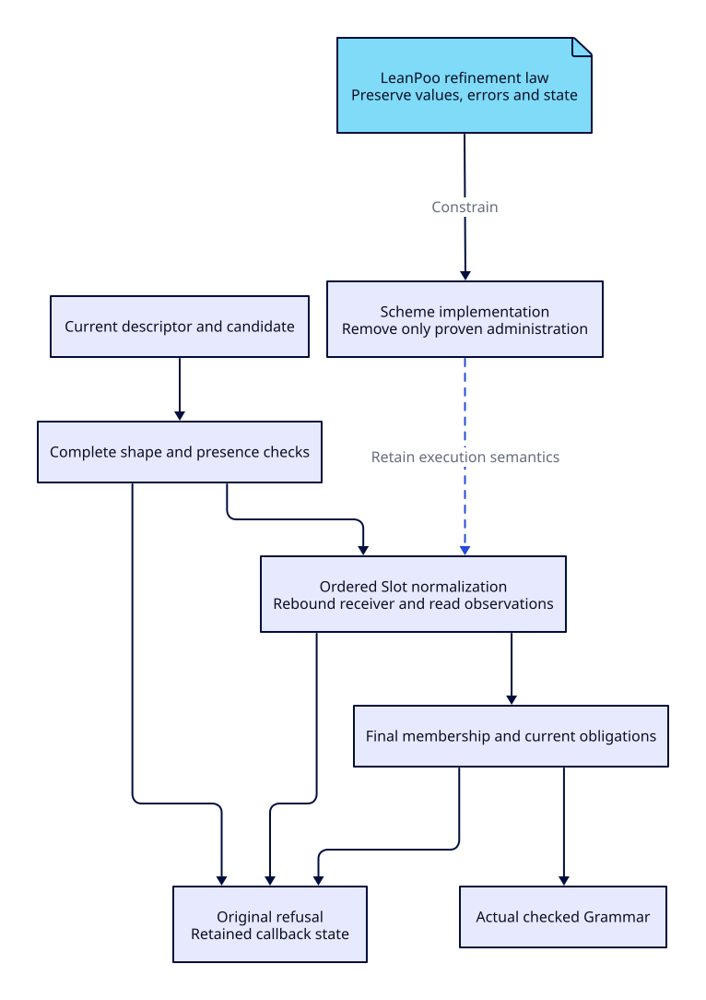

#+TITLE: Checked Grammar construction: algorithms, costs and refinement
#+LANGUAGE: en
#+OPTIONS: toc:2

* Workload and problem boundary

The failing independent operation constructs fifty fresh GrammarRole/Grammar
pairs, twenty samples, under the original 100 ms P95 budget. The retained local
failure is 122.876 ms, not 122 seconds. The later Linux workflow at commit
=76abaabb3f61e770762ed90e8f94b8bc9bcb320d= failed at 143.731276 ms; other
applicable jobs passed. Neither successful source scanning nor a previous
construction pass supersedes these failures. Orgize promotion remains held.

This operation is checked object construction, not LR closure/goto construction.
The existing LR proofs remain authoritative for that separate algorithm.
Changing LR representations without finding them in this measured path would
not address this failure.

The retained original intervals already isolate an important part of the tail:

| Original entry | Samples with GC / total | Non-GC wall range ms | Inner interval nearest the P95 ms | User CPU ms | Included GC wall ms |
|----------------+-------------------------+----------------------+-----------------------------------+-------------+---------------------|
| Local complete entry | 7 / 20 | 58.136--88.746 | 122.860 | 111.183 | 46.846 |
| Linux complete workflow | 7 / 20 | 89.404--109.116 | 143.711 | 143.680 | 51.041 |

The ASP outer receipt is 122.876/143.731276 ms; the nested =##exec-stats=
interval is slightly shorter. Both observations remain intact. GC is included
in elapsed and CPU observations, not an additional phase to add to them.
In the Linux P95 interval, reported user CPU nearly equals elapsed time. Its
slow tail cannot reasonably be attributed entirely to scheduler waiting.
Conversely, some Linux non-GC intervals also exceed 100 ms: eliminating GC
alone would not establish acceptance. The local CPU/wall gap is unclassified;
these counters do not distinguish scheduler delay from all other waiting.

* Observe before changing the algorithm

The source-only diagnostic loads the official Gambit statistical profiler into
the existing compiled workload. It warms the same constructors, samples twenty
fifty-pair batches, restores the heartbeat handler through =dynamic-wind=, checks
the last batch after profiling, writes all indexed counters and exits naturally.
No Contract methods, prototypes, validation slots or dependency hooks are patched.
The profiler is an ignored research input, not a package dependency or runner.

The first profile contains 255 interrupt-stack observations. The following
partition is disjoint by ordered stack predicates: nested Grammar obligations
first, then Record normalization, then contextual admission, then the remainder.
It partitions samples, not elapsed time or allocation.

| Stack category | Observations | Interpretation |
|----------------+--------------+----------------|
| Nested Grammar obligations | 86 | Includes current Role membership/admission |
| Other Record normalization | 84 | Shape, rebound receiver and final membership |
| Other contextual admission | 37 | Classification, obligations and evidence |
| Remaining constructor path | 48 | Slot lookup, observation and other admission work |

Inclusive stacks additionally contain =validate-class= in 125 samples and
=%call-with-recorded-slot-reads= in 106 samples. These overlap with the rows
above and with each other: adding them would double-count work. The profiler
adds substantial overhead and does not measure time while no interrupt can
run. Its counts cannot be multiplied by 122.876 ms to claim a phase breakdown.
Raw =bytes-allocated= values include negative observations; their accounting is
unresolved and is not converted into an allocation improvement claim.

The existing independent =role= and =assembly= cases provide unprofiled costs.
Assembly excludes preparing the roles but still includes their current admission.
Do not subtract their distributions or subtract quantiles to invent component
times. In particular, P95(A+B) is not P95(A)+P95(B).

Both source-only component processes exited naturally with all twenty samples.
The following P50/P95 use nearest-rank quantiles. The Role process overlapped
completion of the focused Lean check; these are diagnostic observations on the
current host, not a controlled speedup or replacement for the pair gate.

| Operation (fifty objects) | Wall P50 ms | Wall P95 ms | User CPU P50 ms | User CPU P95 ms | GC events |
|---------------------------+-------------+-------------+-----------------+-----------------+-----------|
| Fresh checked Role | 16.796 | 43.763 | 16.474 | 43.453 | 2 |
| Grammar around prepared Roles | 32.441 | 79.863 | 32.234 | 65.047 | 4 |

Assembly is the larger observed median component and includes current nested
Role checks. That selects admission/normalization for the next investigation;
it does not license skipping Role validation. GC wall totals across each
twenty-sample process are 57.671 and 129.890 ms respectively. These totals
overlap the timed intervals and must not be added again. Two Role samples and
seven assembly samples report negative allocation counters; those counters
remain raw evidence pending accounting analysis.

An earlier public-method timing probe failed its warmup Contract. That failed
probe is retained and withdrawn; instrumenting a descriptor is not semantically
transparent. The alternative lexical-slot constructor trial failed all six
original gates and was fully reverted.

* Paper alignment and existing owners

[[https://homepages.inf.ed.ac.uk/wadler/topics/deforestation.html][Deforestation: transforming programs to eliminate trees (Wadler)]]
is the reference for removing producer/consumer intermediate structures. Our
restricted map-fusion law is not the paper's general transformation algorithm:
it reuses LeanPoo's established stateful traversal law and explicitly excludes
effectful recipe preparation.

[[https://arxiv.org/abs/1106.0447][Selective Memoization (Acar, Blelloch and Harper, POPL 2003)]]
provides the useful criterion: reuse must expose and respect the computation's
actual dependencies. It does not justify caching validation by object identity.
[[https://arxiv.org/abs/1106.0478][A Consistent Semantics of Self-Adjusting Computation (Acar, Blume and Donham)]]
addresses consistency under mutation. Its change-propagation argument is a
reference for the proof obligation, not a claim that Parser implements that
paper's machine or has imported its proof.

The pinned POO implementation already owns lazy slots and recorded dependency
reads. Yuanxu already prepares the value action on the effective descriptor.
Reuse those owners; a second Parser validation cache or a second prepared-action
registry would duplicate existing mechanisms. A prepared descriptor is reusable
only under the owner's current dependency rules. The candidate, returned
normalized receiver, observer callbacks and current contextual obligations are
still checked at each invocation.

[[https://github.com/gambit/statprof][Gambit's statistical profiler]] supplies the observation mechanism.
Preparation, profiling overhead and ordinary package acceptance remain separate.

* Lean refinement before Scheme changes

[[file:../../formal/ParserEngine/GrammarObjectCosts.lean][GrammarObjectCosts]] imports the pinned LeanPoo =StatefulValidation= and
=ClassValidation=. It introduces no second Contract or object calculus.

| Obligation | Existing semantics or theorem used | Boundary |
|------------+------------------------------------+----------|
| Fuse a pure recipe map into the field traversal | =traverseState_map= | Full presence/shape preflight must remain before normalization |
| Preserve first failure, output ordering and final state | =traverseState_error_iff= | State includes mutation and observer trace; later callbacks must not run |
| Install the actual normalized child | =ClassValidation.present_success= | No identity or idempotence assumption about normalizers |
| Quantify removable administration | =administrative_saving= | Abstract counts; host must establish disjoint measured operations |
| Separate descriptor setup and current admission | =preparation_saving= | Setup validity is not previous candidate acceptance |
| Reject identity-only result reuse | =identity_cache_counterexample= | Same object may acquire invalid fields or obligations |
| Reject eliminating observable repeated validation | =repeated_callback_counterexample= | Successful callbacks can still change state |

For N pairs and per-pair disjoint work W, the operation-count model is N*W.
Removing r verified administrative units gives N*(W-r) and saves N*r units.
It proves neither a millisecond bound nor lower GC pauses. Likewise, preparing
immutable descriptor work p once instead of on every call saves (N-1)*p, while
each call retains its current admission cost. Source inspection must first show
that setup is actually repeated: the existing prepared value action already is
shared and must not be presented as a new optimization.

For descriptor preparation this formula assumes at least one invocation. The
frozen fixture has only eleven Role slots and six Grammar slots. Its asymptotic
cost in the number of fresh pairs is already linear at fixed field counts;
that fact alone cannot explain or fix a 100 ms constant-size gate. Repeated
passes, per-field allocations and retained object graphs still matter. General
LR complexity claims are not performance evidence for this fixture.

The map-fusion candidate removes only an intermediate recipe-list spine.
Its proof assumes a pure adapter over already selected metadata. Real
=class-validation-fields= also performs candidate presence reads; these can be
observed and must not be moved across child callbacks. Therefore this theorem
alone does not authorize replacing that Scheme function. Custom Slot dispatch,
inherited overrides, descriptor mutation, missing optional fields and rebound
receiver dependencies require adapter correspondence before implementation.

* Next executable decision

The focused module and the complete existing =lake build= passed (317 build
tasks). All eight new laws/counterexamples are included in the existing axiom
audit. Their only reported foundations are Lean's =propext=/=Quot.sound=;
both concrete counterexamples require no axioms. No =sorry= or custom axiom
was introduced. Lake fetched the existing locked LeanPoo revision unchanged.
This establishes the abstract laws, not Scheme source correspondence or the
100 ms budget. No Scheme production optimization is included in this step.

The ignored persistent evidence family is =grammar-statistical-profile=:
all twenty indexed samples from each process, original local/Linux interval
breakdowns, source/bundle hashes, folded stacks, focused/full Lean results,
axiom audit and profiler/preparation failures remain retained there. Logs are
not checked into the Parser or Orgize repository.

1. Retain all original pair samples and independent role/assembly samples.
2. Use statistical stacks to select the next cost center, not to claim a ratio.
3. Identify exactly which allocation/traversal is administrative and whether its
   owner is Parser, Yuanxu or POO. Do not move common mechanisms into Parser.
4. Discharge source correspondence and callback ordering against the Lean law;
   include mutable descriptor/list and custom-normalizer counterexamples.
5. Implement that one candidate in Scheme through its current owner, then run
   A/A and ABBA with complete outputs, failures, counters and source identities.
6. Run the original package tests and unchanged 100 ms gate, then exact-head
   Ubuntu/Darwin CI. A diagnostic pass cannot close either acceptance gate.

#+CAPTION: Semantic boundaries retained by an administrative optimization.

