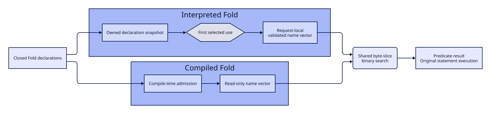
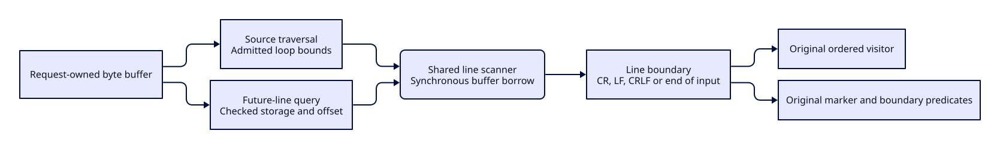

#+title: Request-isolated prepared EventFold state

* Ownership and execution

The engine now prepares a private EventFold program from closed strategy data.
Preparation snapshots pairs and strings, preserves DAG sharing, rejects cycles
and executable values, validates typed initial state, and indexes helper names.
No source, runtime handle, GC root, request cache or mutable working state is
retained in the program. Existing language declarations remain the author path;
this is not a new callback DSL.

Each root/helper layout contains an identity-keyed name index and immutable
initial values (Boolean, unsigned integer or empty stack). A request copies the
initial-value vector. Stack updates, parameter overrides and temporary bindings
belong to that request. Temporary storage is allocated only when used. Removing
and rebinding a declared slot preserves the existing missing-update policy;
duplicate declarations retain first-binding semantics.

The existing declaration macro captures one program at module initialization.
Org's private POO strategy similarly holds the engine program and invokes it
through a thin adapter. There is no downstream compilation cache or new process
launcher. The dynamic =run-event-fold= entry prepares explicit caller data and
uses the same executor; it is not a second parser.

* Static name membership within a request

The interpreted =line-bytes-in-set?= path previously called
=fold-static-name-set= for every selected line and then searched the admitted
list linearly. Admission visits every name and allocates character lists.
The Org name-set workload has twenty physical lines and performs one hundred
complete Folds in each sample, so this path repeats full table admission two
thousand times per sample. A compiler-generated Fold already uses the shared
byte-slice binary search. The interpreted path had not reused that primitive.

#+CAPTION: Declaration ownership and shared name lookup across Fold execution paths.

The candidate admits a name list on its first evaluated use in the existing
request-local byte-predicate owner and retains an ordinary vector index for
that request. Further selected lines invoke =fold-line-name-set-contains?=,
the same byte comparator and binary search as generated Scheme. Uniform byte
vectors and ordinary name vectors are distinct cache witnesses: a name index
must not admit malformed scalar byte operands, even when the byte span is empty.

For N names and L selected lines, repeated full-table admission changes from
L table traversals to one per reached list identity per request. Membership
changes from a linear search to binary search. Program snapshotting and the
remaining statement execution still occur. The unchanged end-to-end workload
continues to perform all one hundred preparations inside its timed interval.
It does not become a prepared-execution-only benchmark.

The owner remains request-local, and initial admission remains lazy. A malformed
name list in an unselected branch is not evaluated. The next request obtains
a fresh owner and must admit current declarations again. Program preparation
still snapshots caller pairs and strings. No process-wide memo or additional
downstream parser is introduced. Compile-time admission remains the generated
path's responsibility; shared lookup does not equate the two admission times.

Validation must cover ASCII slices, near matches and UTF-8 source, malformed
and unsorted names, shared name/byte operands, caller mutation after preparation,
and mutation of exposed program data between requests. The normal package build,
original full Scheme entry and frozen paired workload remain required.
An earlier focused source-only test stopped at its original 120-second limit
while generating the imported =event-lines-grammar= fixture, before Suite
execution. That failed evidence is retained; the existing test-support Build
owner must prepare the fixture before repeating the same test deadline.

** Frozen paired workload

The real Org table contains 392 names. On the original path, twenty selected
lines therefore revisit 784,000 name entries for admission in each hundred-Fold
sample, before the separate sortedness and membership comparisons. The
candidate admits 39,200 entries per sample, retaining all hundred preparations.
These are algorithmic visit counts from the workload and call placement,
not measured CPU percentages.

The first retained observation at Orgize =9a9f63d8= failed with P95 471.793 ms.
The candidate then ran against the installed =e5fdd53= control in A/A and ABBA
order. Each independent process retained all twenty original samples and the
same source, 392-name table, expected events and 100 ms contract. The original
whole-workload entry supplied sampling; no new benchmark runner was added.

| Order | Variant | P50 ms | P95 ms | Maximum ms | Original gate |
|-------+---------+--------+--------+------------+---------------|
| 1 | Control | 413.137 | 635.369 | 878.599 | Fail |
| 2 | Control | 120.193 | 386.632 | 398.621 | Fail |
| 3 | Control | 105.648 | 133.019 | 139.601 | Fail |
| 4 | Candidate | 22.835 | 60.997 | 67.673 | Pass |
| 5 | Candidate | 16.368 | 48.649 | 51.293 | Pass |
| 6 | Control | 278.617 | 674.587 | 705.368 | Fail |

All 120 samples and every failure are retained outside version control.
Four uses of the existing Scheme comparator passed full input, contract,
event and sample-count equivalence. Whole-process user CPU was 6.36--9.51 s
on controls and 4.52--4.54 s on candidates; these figures include startup and
all twenty samples, not just the timed batch. Large A/A variation prevents
a stable speedup ratio claim. No local compilation was active during the
pairing. Host contention was not controlled; machine capacity was twelve
logical CPUs. Both candidate P95 gates passed, while complete package tests
and exact-head CI remain independent obligations. Production ledger failures
in the Rust-owner lanes are not closed by this interpreted-name result.

The subsequent original =just test-all= entry completed naturally with status
zero. Its standard owner prepared the complete test-support import closure;
all 187 source test modules passed, including the EventFold module containing
the new ASCII, cross-kind and mutation controls. The independent fifty-pair
Grammar workload retained twenty samples and passed at P95 83.378 ms against
100 ms. Its source inputs remained admitted before and after execution.
This full-entry success does not relabel the earlier 120-second focused
cold-import timeout as a pass. Exact-head cross-platform CI is still required
before downstream dependency promotion.

The subsequent exact-head cross-platform workflow failed the independent
Grammar construction gate on Linux: P95 135.512 ms against 100 ms. All twenty
diagnostic intervals remain retained. Seven intervals contain GC, with wall
times 129.787--140.189 ms and GC wall intervals about 40--44 ms. The thirteen
without GC take 88.747--108.494 ms. This is evidence of both a narrow CPU margin
and an allocation-sensitive tail, not evidence that host contention alone
explains failure. Allocation counters across collection boundaries are not
treated as reliable per-batch allocation totals. Darwin semantics and all
other applicable Parser lanes passed; the complete workflow is still failed.
No per-sample forced GC, extra heap, relaxed deadline or selective samples
replace the original gate.

* Shared source-line scanning candidate

A diagnostic OS sample under the real =orgize_parse_events= call contains
substantial observations in =event-fold-future=. Module-level observations
do not identify exclusive function cost or prove an end-to-end speedup.
Source review nevertheless finds a duplicate byte-by-byte Scheme loop in
future-line queries. Ordinary source traversal already owns a dedicated
scanner with the same CR, LF, CRLF and EOF rules.

#+CAPTION: One synchronous byte scanner serves traversal and future-line queries.

The follow-up candidate removes that duplicate loop. A checked =source-line-end=
entry admits byte storage and a fixnum offset within the complete buffer before
calling the existing private scanner. The foreign pointer remains call-scoped.
Ordinary traversal retains its admitted loop and ordered callbacks; future
queries retain their original marker, parent-boundary and request-cache logic.
No speculative line index, new scanner, retained pointer or cache is introduced.

The existing source-input Suite compares every offset against an independent
byte oracle, including EOF, the second byte of CRLF and offsets inside a Unicode
scalar. It checks unmodified input and refuses wrong storage, negative,
fractional, oversized and nonnumeric offsets before crossing the foreign boundary.
The original complete entry and matched measurements remain separate
requirements. This change does not close the independent Grammar or production
ledger budget.

** Matched scan component

A source-only diagnostic invokes the installed compiled control procedure and
the compiled checked shared procedure in independent ABBA processes. Both use
the same 53,266-byte mixed-terminator/Unicode source and boundary checksum
5,353,233. Each timed sample traverses the complete buffer twenty times; each
process retains twenty samples. Buffer creation, loading and warmup remain
outside the interval. No diagnostic executable is compiled. This is a component
measurement, with no substituted end-to-end acceptance contract.

| Order | Variant | Wall P50 ms | Wall P95 ms | User CPU P50 ms | User CPU P95 ms |
|-------+---------+-------------+-------------+-----------------+-----------------|
| 1 | Control | 15.873 | 16.360 | 15.818 | 15.835 |
| 2 | Shared scan | 1.404 | 1.459 | 1.363 | 1.389 |
| 3 | Shared scan | 1.380 | 1.399 | 1.361 | 1.362 |
| 4 | Control | 16.375 | 20.405 | 16.284 | 19.592 |

All four processes exited zero. The complete eighty samples have matching
source dimensions, checksums and sample sequences; none contains GC. The
machine exposes twelve logical CPUs. No local build/test was active during
the pair; external host contention is not controlled. Do not project this
component ratio onto complete Org parsing, metadata or the Rust-owner ledger.
All raw samples, failures and source identities remain outside version control.

The first complete source run with the candidate finished with four process
cleanup errors: its sandbox refused =open-process= for =ps=. Its error report
does not implicate the new source-input or EventFold cases, but the complete
entry is failed. A process-enabled retry then correctly refused unissued
=.o2= generations in the reused test output. The failed environments remain
intact. The original full entry was then run in a fresh persistent test prefix
with process inspection allowed. No deadline, pin or workload was changed.

The fresh process-enabled entry subsequently completed all 187 source modules
with final =OK=, including source-input and EventFold cases and all original
process cleanup controls. Its independent Grammar workload still failed:
twenty samples, P95 122.876 ms against 100 ms. The complete =just test-all=
entry therefore remains failed. This is not a line-scan admission success
for the unrelated constructor workload.

** Actual ledger property query

A second ABBA component test consumes the original Rust ledger scenario's
2,000 retained Org files, totaling 557,572 bytes. It calls the actual compiled
=fold-future-marker-before-boundary?= helper with the root property drawer's
declared flags, constant =:END:= bytes and one new suffix cache per document.
Each of twenty samples must match all 2,000 drawers. File loading and warmup
are outside the interval; actual query, cache allocation and GC stay inside.
All document and source hashes, eighty samples and four zero statuses remain
retained. An initial diagnostic import error is retained separately.

| Order | Variant | Wall P50 ms | Wall P95 ms | User CPU P50 ms | User CPU P95 ms |
|-------+---------+-------------+-------------+-----------------+-----------------|
| 1 | Control | 51.998 | 150.723 | 17.848 | 31.368 |
| 2 | Shared scan | 15.352 | 247.109 | 9.222 | 23.960 |
| 3 | Shared scan | 48.036 | 212.457 | 9.379 | 25.842 |
| 4 | Control | 55.636 | 176.153 | 16.966 | 33.787 |

The real short-line query retains a CPU reduction, substantially smaller than
the long-line scanner ratio. Both candidate wall P95 values are worse in this
uncontrolled-host pair. The CPU/wall gap is not proof of its cause; this data
does not qualify wall latency or establish that the end-to-end ledger is fixed.
Do not select the faster median or discard the slow samples. Complete consumer
measurements and unchanged CI gates remain necessary before promotion.

** Constructor representation control

A separate POO lexical-shorthand experiment checked whether constant value
slots would remove the constructor tail. It retained the original public
prototype ancestry, all Contract calls and the frozen fifty-pair workload.
An untimed origin check confirmed that the loaded candidate really used
constant slots, while the control used receiver computations. A/A and ABBA
retained all 120 samples, with unchanged workload hashes.

| Order | Variant | Original P95 ms | User CPU P50 ms | GC count |
|-------+---------+-----------------+-----------------+----------|
| 1 | Control | 147.583 | 69.033 | 7 |
| 2 | Control | 156.533 | 65.831 | 7 |
| 3 | Control | 128.622 | 59.899 | 7 |
| 4 | Lexical values | 166.501 | 72.579 | 7 |
| 5 | Lexical values | 185.839 | 68.287 | 7 |
| 6 | Control | 975.113 | 89.430 | 7 |

All six original gates failed. The candidate showed no stable CPU or GC gain
and was withdrawn; changing slot syntax does not close this workload. The
outlier remains retained, not discarded. Constructor admission, normalization
and evidence allocation still need attribution without weakening their checks.

* Qualification and evidence limits

The first native qualification used =8e98e830= plus this candidate, the existing
Gerbil toolchain and the existing Just owners. All 61 EventFold cases passed, including
five new controls for request isolation, temporary bindings, first declarations,
source snapshots/UTF-8, helper parameters and malformed/cyclic input. The hard
idle watchdog, assertion propagation and final =OK= requirement remain intact.
Subsequent upstream alignment requires fresh qualification; these results are
not relabelled as a different source revision.

The consumer's =021f97a7= diagnostic baseline completed 2,032 physical native
requests for 2,000 documents: 32 parser batches plus 2,000 document-semantic
crossings. Its first sample reported 754.850ms batch owner thread CPU and
810.139ms all-request owner thread CPU. Rust syntax/graph/record stage wall sums
were about 50ms. These counters have different scopes; overlapping worker wall
sums, VM GC intervals and operation waits cannot be added as exclusive costs.

The observed baseline gate still failed. Wall times were unstable under other
host workloads: diagnostic best-of-five was 1.402s; a separate untraced run was
2.868s. Neither result is an optimization claim or a replacement for earlier
602ms/597ms historical samples. The original 100ms threshold is unchanged.

* Remaining closure

State preparation removes repeated layout construction and per-slot cells,
not all strategy interpretation. =fold-statements= and predicate evaluation
still inspect forms at runtime. Direct native strategy specialization remains
an engine responsibility. Static byte-set preparation and per-document semantic
crossings also require attribution and matched controls before further changes.

Prepared-state functionality, complete consumer parity, both runtime choices,
1,000/10,000-document concurrency and the unchanged latency gate are separate
admissions. Native compilation or a passing unit suite alone closes none of the
remaining performance gates.
