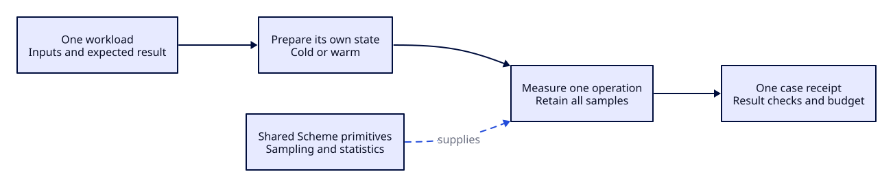

#+TITLE: High-performance parsing framework for the Scheme-owned engine

Current architecture decision and unified acceptance plan:
[[file:../architecture/0010-persistent-recognition-snapshots.org][RFC 0010: Persistent recognition snapshots and explicit publication]].
Historical experiments below remain receipts, rather than independent migration priorities.
#+DATE: 2026-09-28
#+OPTIONS: toc:2

* Independent Scheme benchmarks

Coverage is a catalog of independent operations. Each benchmark owns one
workload, one initial state, one measurement interval and one acceptance rule.
The existing ASP contract and stage sampler supply shared measurement and
reporting. They do not combine outcomes into one timing score.

#+CAPTION: The execution boundary of one independent benchmark case.

| Operation | State at measurement start | Evidence boundary |
|-----------+----------------------------+-------------------|
| Module startup | New Gerbil process and the declared input artifacts | Load and initialization; retain host/process time separately |
| Role construction | Fixed role declaration fields | Fresh checked role; separate from enclosing grammar assembly |
| Grammar assembly | Prepared role inputs and the declared parent/composition lists | Current obligations and the returned grammar; exclude role preparation |
| Grammar object construction | Fresh roles and grammars; existing warmup and GC precondition | Existing 50-pair workload, 20 samples and 100 ms P95 contract |
| LR table construction | Declared grammar and no prepared table | Complete table and semantic equivalence |
| Lexical scan | Prepared scanner and fixed source bytes | Token sequence and exact source coverage |
| LR execution | Prepared table and admitted tokens | Recognition and reduction result; exclude token preparation |
| Artifact publication | Completed recognition result and original source | Exact canonical output and lossless roundtrip |
| Incremental update | An independently prepared base and the declared edit | Complete updated output matches a fresh parse |
| End-to-end parsing | Complete source input and an explicitly cold or warm parser | Whole request, including its actual publication path |

Each case runs independently. Diagnostic sequences that report several stages
remain comparison aids; their outputs are not a shared timing interval or
proof that stage totals add to an end-to-end result. A cold case needs a new
process, and a warm case declares its warmup. Retain raw samples, semantic
refusals, CPU and wall observations, and GC and allocation evidence where the
sampler can attribute it. A missing allocation observation is not zero.
Role-only and assembly-only are separate diagnostic cases to qualify; the
existing pair contract stays intact. Do not infer either isolated cost by
subtracting one timing distribution from another.

The grammar construction case can be run on its own from the package root,
with the Parser and development dependencies available:

#+begin_src sh
gerbil env gxi t/benchmarks/poo-grammar-objects/construction.ss
#+end_src

The original [[file:../../t/core-observability-test.ss][observability Suite]]
imports the benchmark as a source leaf. The existing
[[file:../../build-test-support.ss][test support Build entry]] obtains its
compilation closure from =gerbil-parser.init.exports.tests= and consumes the
issued =std-make-spec=. The benchmark leaf declares its actual imports; it does
not register another source root or maintain a second build inventory.
The standalone case and the Suite consume the same Scheme workload and
[[file:../../t/benchmarks/poo-grammar-objects/benchmark.ss][ASP contract]].
The standalone process emits the original receipt before reporting success or
failure, and exits naturally. It does not run module startup, parser execution,
or the Suite's separate memory-policy case inside the construction interval.

* Qualification plan from Gerbil's typed markup implementation

The upstream TAL reader and compiler operate at expansion time. The reader
retains offsets for diagnostics, and the compiler emits a template procedure.
The markup input layer separates buffered input from the byte scanner helpers
needed at expansion time. XML and HTML construct typed nodes, and their writers
apply the output rules of each language. [[https://git.cons.io/mighty-gerbils/gerbil/pulls/1515][Gerbil PR 1515]]

The upstream implementation uses =:std/io= for buffered Reader and Writer
adapters, =:std/io/bio= buffer storage and reservation for emission, and
=:std/struct/rbtree= for names that exceed the scanner's bounded probe limit.
UTF-8 primitives serve encoding and validation. Byte classes, state transitions
and the common name probe remain local to the tokenizer. Its benchmark selects
one operation, size and iteration count for each invocation.

| Candidate | Existing Parser owner | Independent workload | Required semantic evidence |
|-----------+-----------------------+-----------------------+----------------------------|
| Source-aware syntax expansion | =src/grammar/declaration-syntax.ss= | Expand a valid role or compose declaration at a fixed size. Run refusal cases separately. | Same checked constructor inputs and hygienic bindings. Report an unknown operator at its token. |
| Ordered normalization | =src/compiler/normalize.ss= | Normalize a prepared grammar. Run unique-key growth and repeated override history as separate workloads. | Exact Grammar IR and composition digest. Preserve first owner, callback order, override position and remove-append history. |
| Span-based scanning | =src/runtime/source-scanner.ss= and =src/runtime/scan/basic.ss= | Scan a prepared ASCII, mixed Unicode or long-token fixture in its own process. | Same token kinds, lexemes, byte spans, EOF and refusal. The pinned =:std/string/utf8= offers =string-utf8-length= over a string range. Measure its effect before selecting it. |
| Buffered source ingress | Existing source input boundary | Read the same fixture through each supported input representation. Measure transfer and decode separately from scanning. | Identical source bytes and error offsets across chunk cuts. Compare existing readers with =:std/io= buffered readers. |
| Buffered publication | Existing artifact and output owners | Emit a prepared artifact to a memory sink or a port in separate workloads. | Byte-for-byte output, correct Unicode and sink failure handling. Use =:std/io/counter= as a byte-count control where applicable. |

Begin with the syntax and normalization cases already connected to the
Grammar IR. The indexed fold has ordinary-key scale evidence and composition
history controls. Its repeated-history scaling remains a separate obligation.
Next profile the scanner boundary where the ordinary path creates a substring
and computes its UTF-8 length. Keep the current lexical result and byte offset
contracts as the oracle. Character classes, name interning and specialized
buffers require a measured cost at that boundary before adoption.

For each performance comparison, record the source and compiler identities,
artifact mode, input digest, warmup and actual concurrency. Run an A/A control
to measure variation, then compare the two compiled variants in both orders.
Each fresh process runs one workload and retains every sample. Report wall and
CPU P50 and P95, GC counts and time, and attributable allocations. Accept a
performance claim when both orders show a CPU improvement beyond the A/A
variation and the wall tail supports the intended use. The unchanged original
gates remain required alongside these stage observations.

The complete Scheme Suite, both Rust runtimes and the wheel verify the
published interfaces. Run them with their existing workloads and limits.
Keep the grammar construction gate distinct from normalization and scanning.
Retain failing receipts and compare source-backed artifacts before advancing
the Parser revision to Orgize.

* Scope and navigation

This index separates design, source correspondence and historical qualification.
Each linked topic retains its original premises, failures and evidence limits.
Host and compiler behavior remain external premises; no host build is required.

- [[file:scheme-parser-performance-framework/working-decision.org][Working decision]]
- [[file:scheme-parser-performance-framework/linear-input-extent-for-parser-directed-lr.org][Linear input extent for parser-directed LR]]
- [[file:scheme-parser-performance-framework/candidate-comparison-after-the-recent-survey.org][Candidate comparison after the recent survey]]
